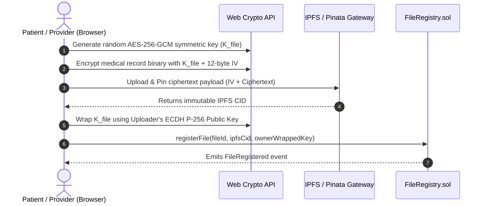
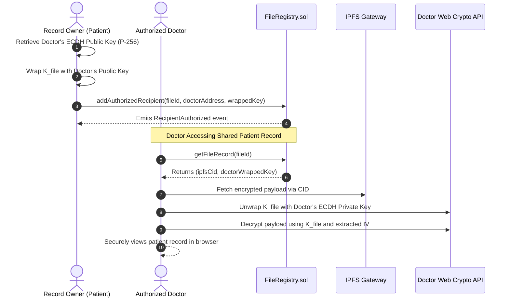
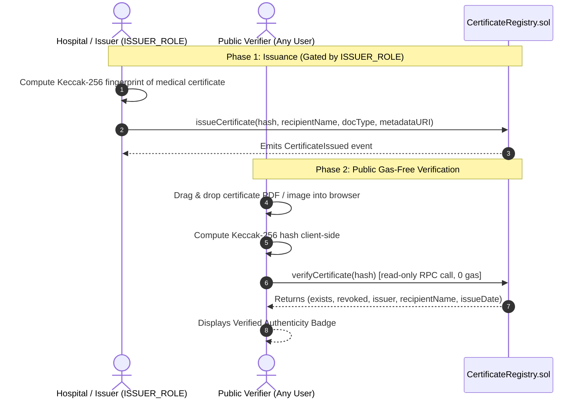

# BlockDrive / MediChain 🛡️🏥

> **Decentralized Electronic Health Record (EHR) Sharing, Role-Based Access Control & On-Chain Credential Verification System**  
> Combining client-side hybrid cryptography (AES-256-GCM & ECDH P-256), IPFS distributed decentralized storage, and Ethereum smart contracts for non-repudiable medical record access governance and verifiable healthcare credentials. Based on cryptographic schemes and blockchain healthcare architectures proposed in decentralized access control literature.

---

## 📑 Table of Contents
- [Overview](#-overview)
- [Key Features](#-key-features)
- [User Roles & Dashboard Isolation](#-user-roles--dashboard-isolation)
- [System Architecture](#-system-architecture)
  - [1. Medical Record Upload & Encryption Flow](#1-medical-record-upload--encryption-flow)
  - [2. Access Sharing & Decryption Flow](#2-access-sharing--decryption-flow)
  - [3. Certificate & Credential Verification Flow](#3-certificate--credential-verification-flow)
- [Smart Contracts](#-smart-contracts)
- [Repository Structure](#-repository-structure)
- [Prerequisites](#-prerequisites)
- [Installation & Quick Start](#-installation--quick-start)
- [Supabase Authentication & RBAC Setup](#-supabase-authentication--rbac-setup)
- [MetaMask Configuration & Development Tips](#-metamask-configuration--development-tips)
- [Testing & Quality Assurance](#-testing--quality-assurance)
- [Deployment to Public Testnets (Sepolia)](#-deployment-to-public-testnets-sepolia)
- [Environment Variables Reference](#-environment-variables-reference)
- [Security & Cryptographic Guarantees](#-security--cryptographic-guarantees)
- [References & Literature Review](#-references--literature-review)
- [License](#-license)

---

## 🌟 Overview

Traditional healthcare and cloud storage systems rely on centralized databases and intermediaries that store sensitive patient health information in plaintext or hold master decryption keys. This centralized paradigm introduces critical single points of failure, vulnerability to data breaches, compliance violations (HIPAA/GDPR), and fragmented patient records.

**BlockDrive / MediChain** eliminates these vulnerabilities through a multi-tier decentralized framework:
1. **Client-Side Hybrid Cryptography**: Files and medical records are encrypted inside the user's browser using AES-256-GCM before transmission. Plaintext data never touches any server, cloud provider, or peer-to-peer node.
2. **Decentralized Distributed Storage (IPFS)**: Encrypted payloads are pinned to IPFS (via Pinata Cloud or local IPFS daemons), addressed immutably by cryptographic Content Identifiers (CIDs).
3. **On-Chain Role-Based Access Control (RBAC)**: Ethereum smart contracts govern user onboarding, role assignments (`DOCTOR_ROLE`, `MEDICAL_STAFF_ROLE`, `PATIENT_ROLE`, `DEFAULT_ADMIN_ROLE`), and dynamic recipient whitelists.
4. **Patient-Centric Data Governance**: Patients maintain full ownership over their health records, granting and revoking access permissions to verified medical practitioners on-demand.
5. **Gas-Free Credential & License Verification**: A dedicated on-chain document fingerprint registry allows institutions to issue tamper-proof medical certificates, licenses, and diplomas, enabling instant public verification with zero gas fees and zero wallet setup.

---

## 🚀 Key Features

- 🔐 **End-to-End In-Browser Encryption**: 256-bit AES-GCM authenticated encryption with 96-bit initialization vectors (IVs) generated via the standard Web Crypto API.
- 🤝 **ECIES / ECDH Key Encapsulation**: Per-recipient AES key wrapping using Elliptic Curve Diffie-Hellman (ECDH) on the P-256 curve, stored directly on-chain.
- 🩺 **4-Role Isolation Portal**: Dedicated authentication and dashboard experiences tailored for **Patients**, **Doctors**, **Medical Staff**, and **Hospital Administrators**.
- 👥 **Admin Dashboard & Account Provisioning**: System administrators can provision user credentials (Email/Password), link Ethereum wallet addresses, onboard healthcare providers on-chain, and audit records.
- 📜 **On-Chain File Access Governance**: `FileRegistry.sol` verifies owner permissions, registers IPFS CIDs, and authorizes recipient public keys.
- 🎓 **Tamper-Proof Certificate Registry**: `CertificateRegistry.sol` issues and revokes Keccak-256 fingerprints of medical licenses, lab reports, and diplomas.
- 🔍 **Public Zero-Gas Verifier**: Anyone can drag-and-drop a document to verify authenticity, issuing authority, and timestamp via read-only JSON-RPC calls.
- ⚡ **Localhost Auto-Faucet**: Integrated JSON-RPC faucet automatically funds newly connected wallets with 100 test ETH on Hardhat local node.
- 🎨 **Modern Responsive UI**: Built with React 18, Vite, Tailwind CSS, Lucide Icons, and Ethers.js v6.

---

## 👥 User Roles & Dashboard Isolation

| Role | Access Level & Capabilities | Primary Components |
|---|---|---|
| **Patient** | • Upload & encrypt personal medical records<br>• Grant / revoke access to doctors and staff<br>• Decrypt and view owned or shared records<br>• Verify medical certificates | [MyFiles.jsx](frontend/src/components/MyFiles.jsx)<br>[UploadFile.jsx](frontend/src/components/UploadFile.jsx)<br>[SharedFiles.jsx](frontend/src/components/SharedFiles.jsx) |
| **Doctor** | • View patient-shared medical histories and diagnostic files<br>• Upload encrypted consultation notes & lab orders<br>• Issue verified medical certificates and prescriptions<br>• Manage authorized patient consultations | [SharedFiles.jsx](frontend/src/components/SharedFiles.jsx)<br>[CertificateIssuer.jsx](frontend/src/features/certificate-verification/CertificateIssuer.jsx)<br>[UploadFile.jsx](frontend/src/components/UploadFile.jsx) |
| **Medical Staff** | • Upload diagnostic imaging, lab test reports, and hospital records<br>• Request and inspect shared patient files<br>• Verify credential validity and hospital clearances | [UploadFile.jsx](frontend/src/components/UploadFile.jsx)<br>[CertificateVerifier.jsx](frontend/src/features/certificate-verification/CertificateVerifier.jsx) |
| **Admin** | • Provision user accounts (email/password in Supabase)<br>• Onboard & revoke on-chain roles (`onboardDoctor`, `onboardMedicalStaff`, `onboardPatient`)<br>• Manage live healthcare directory and assign department attribute bitmasks | [RoleManagement.jsx](frontend/src/components/admin/RoleManagement.jsx)<br>[BlockDriveAccessControl.sol](contracts/BlockDriveAccessControl.sol) |

---

## 🏛️ System Architecture

### 1. Medical Record Upload & Encryption Flow


### 2. Access Sharing & Decryption Flow


### 3. Certificate & Credential Verification Flow


---

## 📜 Smart Contracts

All smart contracts are written in Solidity `^0.8.20` and leverage OpenZeppelin's audited contract libraries.

| Contract | Purpose | Key Functions / Modifiers |
|---|---|---|
| **[`BlockDriveAccessControl.sol`](contracts/BlockDriveAccessControl.sol)** | Manages administrative roles, healthcare provider onboarding (`DOCTOR_ROLE`, `MEDICAL_STAFF_ROLE`, `PATIENT_ROLE`), role revocation, and departmental attribute bitmasks. | `onboardDoctor`, `onboardMedicalStaff`, `onboardPatient`, `revokeHealthcareRole`, `isVerifiedProvider`, `setUserAttributes`, `hasRequiredAttributes` |
| **[`FileRegistry.sol`](contracts/FileRegistry.sol)** | Core file and medical record access registry mapping unique file IDs to IPFS CIDs and per-recipient wrapped decryption keys. | `registerFile`, `addAuthorizedRecipient`, `revokeRecipient`, `getFileRecord`, `isAuthorized`, `ownerFiles` |
| **[`CertificateRegistry.sol`](contracts/CertificateRegistry.sol)** | Tamper-proof medical license, degree, and diagnostic document fingerprint registry with role-gated issuance and revocation. | `issueCertificate`, `revokeCertificate`, `verifyCertificate`, `getCertificate`, `ISSUER_ROLE` |

---

## 📁 Repository Structure

```text
Blockchain-main/
├── contracts/                                  # Solidity Smart Contracts
│   ├── BlockDriveAccessControl.sol             # RBAC & healthcare role governance
│   ├── FileRegistry.sol                        # File metadata & encrypted key distribution
│   └── CertificateRegistry.sol                 # Document fingerprinting & verification
├── frontend/                                   # Vite + React Web Application
│   ├── public/                                 # Static public assets
│   ├── src/
│   │   ├── components/                         # UI & Role-Specific Components
│   │   │   ├── admin/                          # Hospital Admin Dashboard
│   │   │   │   └── RoleManagement.jsx          # User provisioning, directory & on-chain RBAC
│   │   │   ├── AuthModal.jsx                   # Supabase authentication modal
│   │   │   ├── MyFiles.jsx                     # Record manager, recipient sharing & revocation
│   │   │   ├── RequestAccessDecrypt.jsx         # Manual key unwrap & decrypt utility
│   │   │   ├── RoleLogin.jsx                   # Role-specific authentication interface
│   │   │   ├── RoleSelection.jsx               # 4-role portal landing page
│   │   │   ├── SharedFiles.jsx                 # View and decrypt records shared with wallet
│   │   │   ├── UploadFile.jsx                  # Client-side AES encryption & IPFS upload
│   │   │   └── WalletConnect.jsx               # Web3 wallet connection & test faucet button
│   │   ├── features/
│   │   │   └── certificate-verification/       # Credential verification module
│   │   │       ├── CertificateIssuer.jsx       # Role-gated issuance interface
│   │   │       ├── CertificateVerifier.jsx     # Zero-gas public verification tool
│   │   │       └── certificateContracts.js     # Contract ABIs & hashing utilities
│   │   ├── utils/
│   │   │   ├── contracts.js                    # Ethers.js contract connectors & local faucet
│   │   │   ├── crypto.js                       # AES-256-GCM & ECDH P-256 crypto helpers
│   │   │   ├── deployedAddresses.json          # Deployment address configuration
│   │   │   ├── ipfs.js                         # Pinata IPFS upload & gateway fetcher
│   │   │   ├── roles.js                        # On-chain role resolution helper
│   │   │   └── supabaseClient.js               # Supabase client connector
│   │   ├── App.jsx                             # Main routing, role navigation & tab state
│   │   ├── index.css                           # Tailwind CSS styles & animations
│   │   └── main.jsx                            # React entry point
│   ├── package.json                            # Frontend dependencies & scripts
│   └── vite.config.js                          # Vite build configuration
├── scripts/                                    # Hardhat Deployment & Management Scripts
│   ├── deploy.js                               # Deploys contracts & updates frontend config
│   ├── deployCertificateRegistry.js            # Independent certificate registry deployment
│   ├── fundAccount.js                          # Sends local test ETH to any address
│   ├── grantIssuerRole.js                      # Grants ISSUER_ROLE to target wallet
│   ├── seedHealthcareRoles.js                  # Seeds demo doctors, staff, and patients
│   └── supabase_setup.sql                      # SQL setup script for Supabase RBAC profiles
├── test/                                       # Hardhat Automated Test Suite
│   ├── BlockDrive.test.js                      # Unit & integration tests for AccessControl & FileRegistry
│   └── CertificateRegistry.test.js             # Verification & revocation test suite
├── hardhat.config.js                           # Hardhat configuration (Solidity compiler & networks)
├── package.json                                # Root dependencies & scripts
└── README.md                                   # Project documentation & references
```

---

## 🛠️ Prerequisites

Ensure the following tools are installed on your system:
- **Node.js**: `>= 18.0.0` (Recommended: Node 20 LTS or Node 22)
- **npm**: `>= 9.0.0` (bundled with Node.js)
- **MetaMask**: Browser extension for Chrome, Brave, Firefox, or Edge.

---

## ⚡ Installation & Quick Start

### Step 1: Clone and Install Dependencies
```bash
# 1. Clone the repository
git clone https://github.com/Anmol4679/blockchain_project_vit.git
cd blockchain_project_vit

# 2. Install root dependencies (Hardhat, Ethers, OpenZeppelin)
npm install

# 3. Install frontend dependencies (React, Vite, Tailwind CSS)
cd frontend
npm install
cd ..
```

---

### Step 2: Configure Environment Variables
Copy the example environment files:
```bash
# Root environment file (for testnet deployments)
cp .env.example .env

# Frontend environment file (for IPFS and contract addresses)
cp frontend/.env.example frontend/.env
```
*(For local development, the default values in `frontend/.env` work out of the box).*

---

### Step 3: Run the Application (3 Easy Steps)

Open two terminal windows:

#### **Terminal 1: Start Local Hardhat Blockchain**
```bash
npx hardhat node
```
*Starts a local JSON-RPC Ethereum node at `http://127.0.0.1:8545` with 20 pre-funded test accounts (10,000 ETH each).*

#### **Terminal 2: Deploy Contracts & Launch Frontend**
```bash
# Deploy contracts to the local network
npm run deploy:local

# (Optional) Grant certificate issuer role to your testing wallet
npx hardhat run scripts/grantIssuerRole.js --network localhost

# Start the frontend dev server
cd frontend
npm run dev
```

The web application will be accessible at **[`http://localhost:5173/`](http://localhost:5173/)**!

---

## 🗄️ Supabase Authentication & RBAC Setup

For persistent role management and user account provisioning:
1. Create a project at [supabase.com](https://supabase.com).
2. Navigate to the **SQL Editor** in your Supabase dashboard.
3. Paste and run the contents of [`scripts/supabase_setup.sql`](scripts/supabase_setup.sql). This initializes:
   - `profiles` table with `role` enum (`patient`, `doctor`, `medicalStaff`, `admin`).
   - Row Level Security (RLS) policies allowing users to view and update their profiles.
   - Admin-level authorization policies for user provisioning.
4. Add your Supabase credentials to `frontend/.env`:
   ```ini
   VITE_SUPABASE_URL=https://YOUR_PROJECT_ID.supabase.co
   VITE_SUPABASE_ANON_KEY=YOUR_SUPABASE_ANON_KEY
   ```

---

## 🦊 MetaMask Configuration & Development Tips

### Adding the Hardhat Local Network to MetaMask
1. Open the **MetaMask** extension.
2. Click the network dropdown (top-left) and select **Add Network** > **Add a network manually**.
3. Fill in the network parameters:
   - **Network Name**: `Hardhat Localhost`
   - **New RPC URL**: `http://127.0.0.1:8545/`
   - **Chain ID**: `31337`
   - **Currency Symbol**: `ETH`
4. Click **Save** and switch to `Hardhat Localhost`.

### Importing a Pre-Funded Test Account
Hardhat Account #0 has 10,000 test ETH for local testing:
- **Address**: `0xf39Fd6e51aad88F6F4ce6aB8827279cffFb92266`
- **Private Key**: `0xac0974bec39a17e36ba4a6b4d238ff944bacb478cbed5efcae784d7bf4f2ff80`

In MetaMask: click **Account** > **Add Account or Hardware Wallet** > **Import Account** > paste the private key.

### Auto-Funding Any Connected Account
- The frontend features an **automatic local faucet** (`ensureLocalFunds`). Any connected wallet with less than 1.0 ETH is automatically given **100 test ETH** via Hardhat's native `hardhat_setBalance` RPC call.
- You can also click the **`+100 Test ETH`** button in the Web3 Wallet card anytime.

### Important: How to Fix "Transaction Failed" or Nonce Desync in MetaMask
When you restart `npx hardhat node`, the blockchain resets to block #0. MetaMask may keep cached transaction history and nonces, resulting in red "Transaction failed" notifications or nonce errors.  
**To fix this instantly:**
1. Open MetaMask and navigate to **Settings** > **Advanced**.
2. Click **Clear activity tab data** (or **Reset Account** in older versions).
3. This resets MetaMask's transaction history for localhost without deleting your keys or accounts.

---

## 🧪 Testing & Quality Assurance

BlockDrive includes comprehensive automated test suites covering contract deployment, RBAC permissions, encrypted file registration, recipient authorization, and certificate issuance/revocation.

### Run All Unit & Integration Tests
```bash
npx hardhat test
```

### Run Code Coverage Report
```bash
npx hardhat coverage
```

---

## 🌐 Deployment to Public Testnets (Sepolia)

To deploy the contracts to the Ethereum Sepolia Testnet:

1. Obtain Sepolia test ETH from a faucet (e.g. [sepoliafaucet.com](https://sepoliafaucet.com) or [alchemy.com/faucets/ethereum-sepolia](https://www.alchemy.com/faucets/ethereum-sepolia)).
2. Add your credentials to the root `.env` file:
   ```ini
   SEPOLIA_RPC_URL=https://eth-sepolia.g.alchemy.com/v2/YOUR_ALCHEMY_API_KEY
   PRIVATE_KEY=0xYOUR_TESTNET_PRIVATE_KEY
   ETHERSCAN_API_KEY=YOUR_ETHERSCAN_API_KEY
   ```
3. Run the Sepolia deployment script:
   ```bash
   npm run deploy:sepolia
   ```
4. Update `frontend/.env` with the newly deployed contract addresses and set `VITE_RPC_URL` to your Sepolia RPC.

---

## 🔑 Environment Variables Reference

### Root Directory (`.env`)
| Variable | Description | Example |
|---|---|---|
| `SEPOLIA_RPC_URL` | Ethereum Sepolia JSON-RPC endpoint | `https://eth-sepolia.g.alchemy.com/v2/...` |
| `PRIVATE_KEY` | Deployer account private key (hex) | `0x123456789...` |
| `ETHERSCAN_API_KEY` | Etherscan API key for contract verification | `YOUR_ETHERSCAN_API_KEY` |

### Frontend Directory (`frontend/.env`)
| Variable | Description | Default / Example |
|---|---|---|
| `VITE_FILE_REGISTRY_ADDRESS` | Deployed address of `FileRegistry.sol` | `0xe7f1725E7734CE288F8367e1Bb143E90bb3F0512` |
| `VITE_ACCESS_CONTROL_ADDRESS` | Deployed address of `BlockDriveAccessControl.sol` | `0x5FbDB2315678afecb367f032d93F642f64180aa3` |
| `VITE_CERTIFICATE_REGISTRY_ADDRESS` | Deployed address of `CertificateRegistry.sol` | `0x9fE46736679d2D9a65F0992F2272dE9f3c7fa6e0` |
| `VITE_PINATA_API_KEY` | Pinata Cloud IPFS API Key | Pinata API Key |
| `VITE_PINATA_SECRET_API_KEY` | Pinata Cloud IPFS Secret Key | Pinata Secret Key |
| `VITE_PINATA_JWT` | Pinata Cloud JWT Token | Pinata JWT |
| `VITE_IPFS_GATEWAY` | Dedicated IPFS HTTP Gateway URL | `https://gateway.pinata.cloud/ipfs/` |
| `VITE_IPFS_API_URL` | Local IPFS Daemon API endpoint (optional) | `http://127.0.0.1:5001/api/v0` |
| `VITE_SUPABASE_URL` | Supabase project URL (user sessions & RBAC) | `https://your-project.supabase.co` |
| `VITE_SUPABASE_ANON_KEY` | Supabase public anonymous API key | `eyJhbGci...` |

---

## 🔒 Security & Cryptographic Guarantees

1. **Zero-Knowledge Storage Layer**: IPFS only stores the AES-GCM ciphertext prefixed by its unique 12-byte initialization vector (IV). An attacker inspecting IPFS cannot decrypt data without the wrapped key.
2. **Authenticated Encryption (AES-256-GCM)**: Galois/Counter Mode ensures confidentiality and cryptographic integrity. Tampering with ciphertext in transit triggers instant auth-tag verification failure.
3. **No Private Key Transmission**: Private keys (both Ethereum secp256k1 keys and Web Crypto P-256 ECDH keys) are generated and stored strictly within the client browser.
4. **Smart Contract Role Separation**: OpenZeppelin's `AccessControl` restricts administrative functions (onboarding, role granting, revocation) to verified hospital administrators.

---

## 📚 References & Literature Review

This project builds upon foundational research in blockchain technology, decentralized healthcare data management, privacy-preserving electronic health records (EHR), and smart contract access control:

1. Agbo, C. C., Mahmoud, Q., & Eklund, J. M. (2019). Blockchain Technology in Healthcare: A Systematic Review. *Healthcare, 7*. https://doi.org/10.3390/healthcare7020056
2. Arbabi, M. S., Lal, C., Veeraragavan, N., Marijan, D., Nygård, J., & Vitenberg, R. (2023). A Survey on Blockchain for Healthcare: Challenges, Benefits, and Future Directions. *IEEE Communications Surveys & Tutorials, 25*, 386-424. https://doi.org/10.1109/comst.2022.3224644
3. Chukwu, E., & Garg, L. (2020). A Systematic Review of Blockchain in Healthcare: Frameworks, Prototypes, and Implementations. *IEEE Access, 8*, 21196-21214. https://doi.org/10.1109/access.2020.2969881
4. De Aguiar, E. J., Faiçal, B. S., Krishnamachari, B., & Ueyama, J. (2020). A Survey of Blockchain-Based Strategies for Healthcare. *ACM Computing Surveys (CSUR), 53*, 1 - 27. https://doi.org/10.1145/3376915
5. Dhingra, S., Raut, R. D., Naik, K., & Muduli, K. (2024). Blockchain Technology Applications in Healthcare Supply Chains—A Review. *IEEE Access, 12*, 11230-11257. https://doi.org/10.1109/access.2023.3348813
6. Durneva, P., Cousins, K. C., & Chen, M. (2020). The Current State of Research, Challenges, and Future Research Directions of Blockchain Technology in Patient Care: Systematic Review. *Journal of Medical Internet Research, 22*. https://doi.org/10.2196/18619
7. Gordon, W. J., & Catalini, C. (2018). Blockchain Technology for Healthcare: Facilitating the Transition to Patient-Driven Interoperability. *Computational and Structural Biotechnology Journal, 16*, 224 - 230. https://doi.org/10.1016/j.csbj.2018.06.003
8. Hasselgren, A., Kralevska, K., Gligoroski, D., Pedersen, S. A., & Faxvaag, A. (2019). Blockchain in healthcare and health sciences - A scoping review. *International journal of medical informatics, 134*, 104040. https://doi.org/10.1016/j.ijmedinf.2019.104040
9. Hussien, H. M., Yasin, S., Udzir, N., Ninggal, M. I. H., & Salman, S. (2021). Blockchain technology in the healthcare industry: Trends and opportunities. *J. Ind. Inf. Integr., 22*, 100217. https://doi.org/10.1016/j.jii.2021.100217
10. Maher, C., Kuo, T.-T., Kasyapa, M. S. B., & Vanmathi, C. (2024). Blockchain integration in healthcare: a comprehensive investigation of use cases, performance issues, and mitigation strategies. *Frontiers in Digital Health, 6*. https://doi.org/10.3389/fdgth.2024.1359858
11. McGhin, T., Choo, K.-K. R., Liu, C. Z., & He, D. (2019). Blockchain in healthcare applications: Research challenges and opportunities. *J. Netw. Comput. Appl., 135*, 62-75. https://doi.org/10.1016/j.jnca.2019.02.027
12. Ramzan, S., Aqdus, A., Ravi, V., Koundal, D., Amin, R., & Ghamdi, M. A. A. (2023). Healthcare Applications Using Blockchain Technology: Motivations and Challenges. *IEEE Transactions on Engineering Management, 70*, 2874-2890. https://doi.org/10.1109/tem.2022.3189734
13. Saeed, H., Malik, H., Bashir, U., Ahmad, A., Riaz, S., Ilyas, M., Bukhari, W. A., & Khan, M. I. A. (2022). Blockchain technology in healthcare: A systematic review. *PLoS ONE, 17*. https://doi.org/10.1371/journal.pone.0266462
14. Soltanisehat, L., Alizadeh, R., Hao, H., & Choo, K.-K. R. (2020). Technical, Temporal, and Spatial Research Challenges and Opportunities in Blockchain-Based Healthcare: A Systematic Literature Review. *IEEE Transactions on Engineering Management, PP*, 1-16. https://doi.org/10.1109/tem.2020.3013507
15. Sundar, A. J., Isravel, D. P., Sagayam, K., Bhushan, B., Sei, Y., & Eunice, J. (2023). Blockchain for healthcare systems: Architecture, security challenges, trends and future directions. *J. Netw. Comput. Appl., 215*, 103633. https://doi.org/10.1016/j.jnca.2023.103633
16. Tandon, A., Dhir, A., Islam, A. N. N., & Mäntymäki, M. (2020). Blockchain in healthcare: A systematic literature review, synthesizing framework and future research agenda. *Comput. Ind., 122*, 103290. https://doi.org/10.1016/j.compind.2020.103290
17. Tanwar, S., Parekh, K., & Evans, R. (2020). Blockchain-based electronic healthcare record system for healthcare 4.0 applications. *J. Inf. Secur. Appl., 50*. https://doi.org/10.1016/j.jisa.2019.102407
18. Villarreal, E., García-Alonso, J., Moguel, E., & Alegría, J. (2024). Blockchain for Healthcare Management Systems: A Survey on Interoperability and Security. *IEEE Access, 11*, 5629-5652. https://doi.org/10.1109/access.2023.3236505
19. Xie, Y., Zhang, J.-Y., Wang, H., Liu, P., Liu, S.-X., Huo, T.-T., Duan, Y.-Y., Dong, Z., Lu, L., & Ye, Z.-W. (2021). Applications of Blockchain in the Medical Field: Narrative Review. *Journal of Medical Internet Research, 23*. https://doi.org/10.2196/28613
20. Yaqoob, I., Salah, K., Jayaraman, R., & Al-Hammadi, Y. (2021). Blockchain for healthcare data management: opportunities, challenges, and future recommendations. *Neural Computing and Applications, 34*, 11475 - 11490. https://doi.org/10.1007/s00521-020-05519-w

---

## 📄 License

This project is licensed under the [MIT License](LICENSE).
