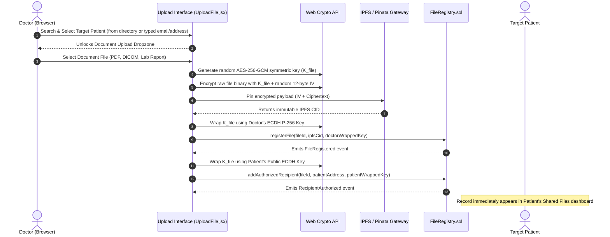
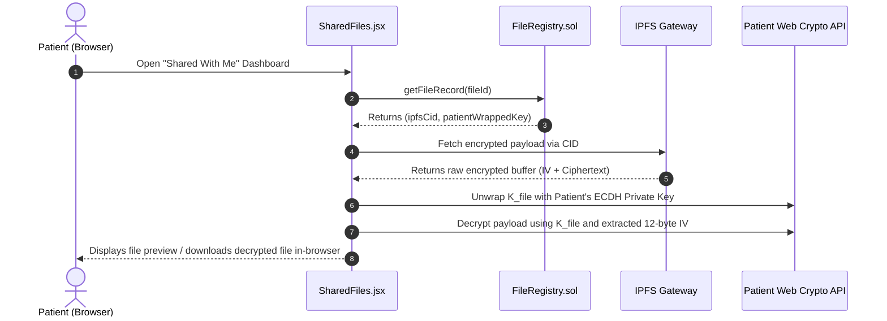
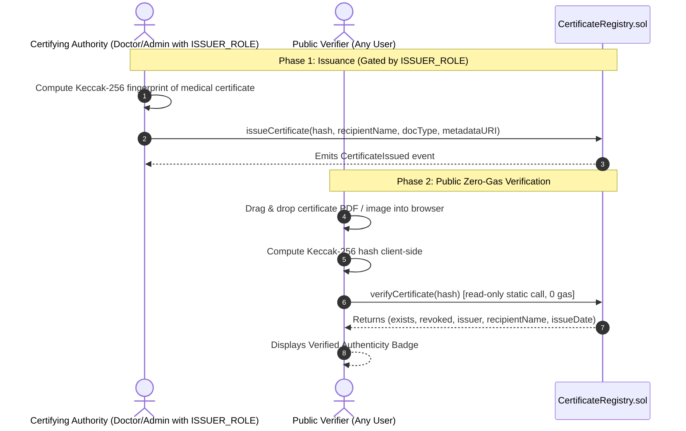

# BlockDrive / MediChain 

> **Decentralized Electronic Health Record (EHR) Sharing, Healthcare Role-Based Access Control & On-Chain Credential Verification System**  
> Combining client-side hybrid cryptography (AES-256-GCM & ECDH P-256), IPFS distributed decentralized storage, Ethereum smart contracts, and Supabase RBAC for non-repudiable medical record access governance and verifiable healthcare credentials. Based on cryptographic schemes and blockchain healthcare architectures proposed by Wang, Zhang & Zhang (*IEEE Access* 2018, [DOI: 10.1109/ACCESS.2018.2851611](https://doi.org/10.1109/ACCESS.2018.2851611)) and decentralized EHR access literature.

---

## 📑 Table of Contents
- [Overview](#-overview)
- [Key Features](#-key-features)
- [Healthcare Role-Based Access Control (RBAC)](#-healthcare-role-based-access-control-rbac)
- [System Architecture & Workflows](#-system-architecture--workflows)
  - [1. Doctor-to-Patient Targeted Upload & Encryption Flow](#1-doctor-to-patient-targeted-upload--encryption-flow)
  - [2. Patient File Decryption & Retrieval Flow](#2-patient-file-decryption--retrieval-flow)
  - [3. Gas-Free Certificate & Credential Verification Flow](#3-gas-free-certificate--credential-verification-flow)
- [Smart Contracts & Addresses](#-smart-contracts--addresses)
- [Repository Structure](#-repository-structure)
- [Database Setup (Supabase RBAC)](#-database-setup-supabase-rbac)
- [Prerequisites](#-prerequisites)
- [Installation & Quick Start](#-installation--quick-start)
- [MetaMask Configuration & Local Faucet](#-metamask-configuration--local-faucet)
- [Testing & Quality Assurance](#-testing--quality-assurance)
- [Deployment to Public Testnets (Sepolia)](#-deployment-to-public-testnets-sepolia)
- [Environment Variables Reference](#-environment-variables-reference)
- [Security & Cryptographic Guarantees](#-security--cryptographic-guarantees)
- [References & Literature Review](#-references--literature-review)
- [License](#-license)

---

##  Overview

Traditional healthcare and cloud storage systems rely on centralized databases and custodial access controls where plaintext records or master encryption keys are vulnerable to data breaches, unauthorized leaks, ransomware, compliance violations (HIPAA/GDPR), and single points of failure.

**BlockDrive / MediChain** eliminates these vulnerabilities through a multi-tier decentralized framework:
1. **Client-Side Zero-Knowledge Encryption**: Every medical file or document is encrypted inside the user's browser using AES-256-GCM before transmission. Plaintext data never touches any server, cloud provider, or peer-to-peer node.
2. **Decentralized Distributed Storage (IPFS)**: Encrypted payloads are pinned to IPFS (via Pinata Cloud or local IPFS daemons), addressed immutably by cryptographic Content Identifiers (CIDs).
3. **On-Chain Role-Based Access Control (RBAC)**: Ethereum smart contracts govern user onboarding, role assignments (`DOCTOR_ROLE`, `MEDICAL_STAFF_ROLE`, `PATIENT_ROLE`, `DEFAULT_ADMIN_ROLE`), and dynamic recipient whitelists.
4. **Patient-Centric Data Governance**: Patients maintain full ownership over their health records, granting and revoking access permissions to verified medical practitioners on-demand.
5. **Doctor-to-Patient Targeted Workflows**: Clinicians can search real registered patients, select a recipient, and assign encrypted consultation records directly to that patient's private vault with instantaneous client decryption.
6. **Gas-Free Credential & License Verification**: A dedicated on-chain document fingerprint registry allows institutions to issue tamper-proof medical certificates, licenses, and diplomas, enabling instant public verification with zero gas fees and zero wallet setup.
7. **High-Contrast Monochromatic UI**: A focused, accessible user interface adhering strictly to high-contrast typography (`#000000` / `#ffffff`), clean micro-interactions, and clear visual hierarchy.

---

##  Key Features

-  **End-to-End Client Encryption**: 256-bit AES-GCM authenticated encryption with unique 96-bit initialization vectors (IVs) generated in-browser via the Web Crypto API.
-  **ECIES / ECDH Key Encapsulation**: AES symmetric keys are wrapped per recipient using Elliptic Curve Diffie-Hellman (ECDH) on curve P-256 and stored on-chain.
-  **Dedicated 4-Role Healthcare Portal**: Tailored dashboards and workflows for **Doctors**, **Patients**, **Medical Staff**, and **Hospital Administrators**.
-  **Doctor-to-Patient Targeted Upload**:
  - Real-time search and directory filtering for registered patients.
  - Two-step sequential workflow: Select patient -> unlock document upload dropzone.
  - Direct selection support for typed patient emails or Ethereum wallet addresses.
  - Option to route files to personal clinical vault or directly to the target patient.
- 📂 **Patient Shared Vault**: Assigned medical records automatically appear in the patient's "Shared With Me" view for one-click in-browser decryption and viewing.
- **Admin Onboarding & Provisioning**: System administrators can provision user credentials (Email/Password in Supabase), link Ethereum wallet addresses, onboard healthcare providers on-chain, and audit records.
   *-*IPFS Lifecycle Management**: Built-in functionality to delete individual records or clear all cached records from local tracking and IPFS.
-  **On-Chain File Access Governance**: `FileRegistry.sol` verifies owner authorization, logs file creation events, and maintains active recipient whitelists.
- *Independent Certificate Registry**: `CertificateRegistry.sol` allows designated authorities (`ISSUER_ROLE`) to stamp cryptographic fingerprints (Keccak-256) of certificates with instant revocation controls.
-  **Public Read-Only Verification**: Anyone can upload a document or enter its hash to instantly verify authenticity with zero gas fees and zero wallet setup.
-  **Auto-Faucet for Localhost**: Hardhat JSON-RPC integration automatically funds connected test accounts with 100 local test ETH, eliminating "insufficient funds" transaction failures.
-  **Hybrid Authentication**: Supabase RBAC user authentication integrated alongside Web3 Ethereum wallet signatures.

---

## 👥 Healthcare Role-Based Access Control (RBAC)

The application provides four role profiles:

| Role | Access Level & Capabilities | Primary Components |
|---|---|---|
| **Patient** | • Upload & encrypt personal medical records<br>• View files shared by doctors in "Shared With Me"<br>• In-browser instant client decryption<br>• Request access to specific medical records<br>• Verify medical certificates | [`MyFiles.jsx`](frontend/src/components/MyFiles.jsx)<br>[`SharedFiles.jsx`](frontend/src/components/SharedFiles.jsx)<br>[`UploadFile.jsx`](frontend/src/components/UploadFile.jsx) |
| **Doctor** | • Search patient directory & assign records to specific patients<br>• Two-step upload: Select patient -> Upload encrypted document<br>• Manage personal clinical vault<br>• Issue verified medical certificates and prescriptions | [`UploadFile.jsx`](frontend/src/components/UploadFile.jsx)<br>[`SharedFiles.jsx`](frontend/src/components/SharedFiles.jsx)<br>[`CertificateIssuer.jsx`](frontend/src/features/certificate-verification/CertificateIssuer.jsx) |
| **Medical Staff** | • View authorized departmental files and test reports<br>• Inspect shared patient files according to on-chain permissions<br>• Verify credential validity and hospital clearances | [`UploadFile.jsx`](frontend/src/components/UploadFile.jsx)<br>[`SharedFiles.jsx`](frontend/src/components/SharedFiles.jsx)<br>[`CertificateVerifier.jsx`](frontend/src/features/certificate-verification/CertificateVerifier.jsx) |
| **Administrator** | • Provision user accounts (email/password in Supabase)<br>• Onboard & revoke on-chain roles (`onboardDoctor`, `onboardMedicalStaff`, `onboardPatient`)<br>• Audit system records and user activity<br>• Grant or revoke `ISSUER_ROLE` on-chain | [`RoleManagement.jsx`](frontend/src/components/admin/RoleManagement.jsx)<br>[`BlockDriveAccessControl.sol`](contracts/BlockDriveAccessControl.sol) |

---

##  System Architecture & Workflows

### 1. Doctor-to-Patient Targeted Upload & Encryption Flow


---

### 2. Patient File Decryption & Retrieval Flow


---

### 3. Gas-Free Certificate & Credential Verification Flow


---

##  Smart Contracts & Addresses

All smart contracts are developed with Solidity `^0.8.20` utilizing OpenZeppelin audited contracts.

| Contract | Purpose | Key Functions / Events |
|---|---|---|
| **[`BlockDriveAccessControl.sol`](contracts/BlockDriveAccessControl.sol)** | Manages administrative roles, authorization bitmasks, and multi-attribute identity policies. | `hasRole`, `grantRole`, `hasRequiredAttributes`, `setUserAttributes`, `onboardDoctor`, `onboardPatient` |
| **[`FileRegistry.sol`](contracts/FileRegistry.sol)** | Core file access governance layer mapping files to IPFS CIDs and per-recipient wrapped keys. | `registerFile`, `addAuthorizedRecipient`, `revokeRecipient`, `getFileRecord`, `isAuthorized` |
| **[`CertificateRegistry.sol`](contracts/CertificateRegistry.sol)** | Tamper-proof medical, academic, and credential verification registry with role governance. | `issueCertificate`, `revokeCertificate`, `verifyCertificate`, `getCertificate`, `ISSUER_ROLE` |

### Default Localhost Deployment Addresses (`chainId: 31337`):
- **`BlockDriveAccessControl`**: `0xe7f1725E7734CE288F8367e1Bb143E90bb3F0512`
- **`FileRegistry`**: `0x9fE46736679d2D9a65F0992F2272dE9f3c7fa6e0`
- **`CertificateRegistry`**: `0xCf7Ed3AccA5a467e9e704C703E8D87F634fB0Fc9`

*(Deployment addresses are automatically written to [`frontend/src/utils/deployedAddresses.json`](frontend/src/utils/deployedAddresses.json) upon running `npm run deploy:local`).*

---

##  Repository Structure

```text
blockchain_project_vit/
├── contracts/                        # Solidity smart contracts
│   ├── BlockDriveAccessControl.sol   # Role-based & attribute-based permissions
│   ├── FileRegistry.sol              # File metadata & encrypted key distribution
│   └── CertificateRegistry.sol       # Document fingerprinting & verification
├── frontend/                         # React 18 + Vite Web Application
│   ├── public/                       # Static public assets
│   ├── src/
│   │   ├── components/               # Core application components
│   │   │   ├── admin/
│   │   │   │   └── RoleManagement.jsx# Admin user management & RBAC governance
│   │   │   ├── AuthModal.jsx         # Supabase authentication modal
│   │   │   ├── MyFiles.jsx           # File manager, recipient whitelist & IPFS delete
│   │   │   ├── RequestAccessDecrypt.jsx # Manual decryption tool
│   │   │   ├── RoleLogin.jsx         # Dedicated role-based login interface
│   │   │   ├── RoleSelection.jsx     # Role selection gateway
│   │   │   ├── SharedFiles.jsx       # Files shared with connected wallet/patient
│   │   │   ├── UploadFile.jsx        # Doctor patient search & client encryption upload
│   │   │   └── WalletConnect.jsx     # Web3 wallet connection & balance monitor
│   │   ├── context/
│   │   │   └── RoleContext.jsx       # Global RBAC role provider & session manager
│   │   ├── features/
│   │   │   └── certificate-verification/ # Tamper-proof certificate module
│   │   │       ├── CertificateIssuer.jsx   # Role-gated issuance interface
│   │   │       ├── CertificateVerifier.jsx # Public zero-gas verification interface
│   │   │       └── certificateContracts.js # Contract ABIs & hashing utilities
│   │   ├── utils/
│   │   │   ├── contracts.js          # Ethers contract connectors & faucet helpers
│   │   │   ├── crypto.js             # AES-256-GCM & ECDH P-256 Web Crypto functions
│   │   │   ├── deployedAddresses.json# Auto-updated deployed contract addresses
│   │   │   ├── ipfs.js               # Pinata Cloud IPFS upload & gateway downloader
│   │   │   ├── roles.js              # Role definitions, constants & permissions
│   │   │   └── supabaseClient.js     # Supabase client connector
│   │   ├── App.jsx                   # Application layout, navigation & tab state
│   │   ├── index.css                 # Clean, high-contrast black & white styles
│   │   └── main.jsx                  # React application entry point
│   ├── package.json                  # Frontend dependencies
│   ├── tailwind.config.js            # Tailwind configuration
│   └── vite.config.js                # Vite build configuration
├── docs/                             # Additional technical documentation
│   └── CERTIFICATE_VERIFICATION.md   # Detailed certificate module architecture
├── scripts/                          # Hardhat deployment & diagnostic scripts
│   ├── checkFiles.js                 # Verify files recorded on-chain
│   ├── deploy.js                     # Deploys contracts & updates frontend config
│   ├── diagnose.js                   # Diagnostic check for contracts and RPC
│   ├── fundAccount.js                # Helper script to send local test ETH
│   ├── grantIssuerRole.js            # Grant ISSUER_ROLE to target addresses
│   ├── onboardRecipient.js           # Register testing recipient keys
│   ├── supabase_setup.sql            # Supabase database schema & RLS setup
│   └── testRegister.js               # On-chain registration test script
├── test/                             # Hardhat automated test suite
│   └── BlockDrive.test.js            # Comprehensive unit & integration tests (26 passing)
├── hardhat.config.js                 # Hardhat configuration (Solidity compiler & networks)
├── package.json                      # Root configuration and dependencies
└── README.md                         # Project documentation
```

---

##  Database Setup (Supabase RBAC)

To enable user accounts, patient directory search, and role persistence:

1. Create a project at [supabase.com](https://supabase.com).
2. Navigate to **SQL Editor** in your Supabase dashboard.
3. Open [`scripts/supabase_setup.sql`](scripts/supabase_setup.sql) in this repository, copy its contents, and run it.
4. This script automatically configures:
   - `public.profiles` table linked to `auth.users`.
   - Strict healthcare roles: `'admin'`, `'doctor'`, `'patient'`, `'medicalStaff'`.
   - Row Level Security (RLS) policies allowing users to view their own profile and admins to manage all profiles.
   - Database trigger to automatically synchronize Supabase Auth sign-ups into the `profiles` table.
5. Copy your **Project URL** and **Anon Key** from **Project Settings > API** into `frontend/.env`.

---

##  Prerequisites

Ensure you have the following installed on your machine:
- **Node.js**: `>= 18.0.0` (Node 20 LTS or Node 22 recommended)
- **npm**: `>= 9.0.0`
- **MetaMask**: Browser extension for Chrome, Brave, Firefox, or Edge.

---

##  Installation & Quick Start

### Step 1: Clone the Repository & Install Dependencies
```bash
# 1. Clone the repository
git clone https://github.com/Anmol4679/blockchain_project_vit.git
cd blockchain_project_vit

# 2. Install root dependencies (Hardhat, Ethers, OpenZeppelin)
npm install

# 3. Install frontend dependencies (React, Vite, Tailwind CSS)
cd frontend
npm install
cd ..
```

---

### Step 2: Configure Environment Files
```bash
# Root environment file (for testnet deployments)
cp .env.example .env

# Frontend environment file (for IPFS, contracts, and Supabase)
cp frontend/.env.example frontend/.env
```
*(For local development, the default contract addresses in `frontend/.env` are pre-configured to work out of the box).*

---

### Step 3: Run the Application (3 Easy Steps)

Open two terminal windows:

#### **Terminal 1: Start Local Hardhat Blockchain**
```bash
npx hardhat node
```
*Starts a local JSON-RPC Ethereum node on `http://127.0.0.1:8545` with 20 pre-funded test accounts (10,000 ETH each).*

#### **Terminal 2: Deploy Contracts & Launch Frontend**
```bash
# Deploy contracts to the local network and update frontend addresses
npm run deploy:local

# (Optional) Grant certificate issuer role to your testing wallet
npx hardhat run scripts/grantIssuerRole.js --network localhost

# Start the frontend dev server
cd frontend
npm run dev
```

The web application is now running at **[`http://localhost:5173/`](http://localhost:5173/)**!

---

##  MetaMask Configuration & Local Faucet

### Adding the Hardhat Local Network to MetaMask
1. Open the **MetaMask** extension.
2. Click the network dropdown (top-left) and select **Add Network** > **Add a network manually**.
3. Fill in the network details:
   - **Network Name**: `Hardhat Localhost`
   - **New RPC URL**: `http://127.0.0.1:8545/`
   - **Chain ID**: `31337`
   - **Currency Symbol**: `ETH`
4. Click **Save** and switch to `Hardhat Localhost`.

### Importing a Pre-Funded Test Account
Hardhat Account #0 has 10,000 test ETH for local testing:
- **Address**: `0xf39Fd6e51aad88F6F4ce6aB8827279cffFb92266`
- **Private Key**: `0xac0974bec39a17e36ba4a6b4d238ff944bacb478cbed5efcae784d7bf4f2ff80`

In MetaMask: click **Account** > **Add Account or Hardware Wallet** > **Import Account** > paste the private key.

### Auto-Funding Connected Accounts
The application includes an **automatic local faucet** (`ensureLocalFunds`). Any connected wallet with less than 1.0 ETH is automatically credited **100 test ETH** via Hardhat's `hardhat_setBalance` RPC call, preventing transaction failures during testing.

### How to Fix Nonce Desync in MetaMask
When you restart `npx hardhat node`, the local chain resets to block #0. If MetaMask holds old cached transaction history:
1. Open MetaMask and navigate to **Settings** > **Advanced**.
2. Click **Clear activity tab data** (or **Reset Account**).
3. This synchronizes your transaction nonce with the newly started blockchain.

---

##  Testing & Quality Assurance

BlockDrive includes an automated test suite covering contract deployment, access controls, encrypted file registration, authorization granting/revoking, and certificate issuance/revocation.

### Run Unit Tests
```bash
npx hardhat test
```
**Expected Output:**
```text
  BlockDrive Contracts
    AccessControl
      ✔ should set and verify user attributes
      ✔ should reject non-admin attribute update
    FileRegistry
      ✔ should register a file and emit FileRegistered event
      ✔ should reject duplicate file registration
      ✔ should allow authorized owner to retrieve file record and wrapped key
      ✔ should allow owner to add authorized recipient and emit RecipientAuthorized
      ✔ should reject unauthorized caller attempting to retrieve file record
      ✔ should reject non-owner attempting to add authorized recipient
      ✔ should allow owner to revoke recipient authorization
    CertificateRegistry
      ✔ should assign DEFAULT_ADMIN_ROLE and ISSUER_ROLE to deployer/admin
      ✔ should allow admin to grant and revoke ISSUER_ROLE
      ✔ should reject non-admin trying to grant ISSUER_ROLE
      ✔ should allow authorized issuer to issue certificate and emit CertificateIssued event
      ✔ should reject duplicate certificate hash registration
      ✔ should reject certificate issuance with empty hash, recipient, or documentType
      ✔ should reject non-issuer attempting to issue certificate
      ✔ should return valid verification details for an existing certificate
      ✔ should return exists=false for non-existent document hash
      ✔ should allow querying full certificate record via getCertificate
      ✔ should revert getCertificate for non-existent hash
      ✔ should allow the original issuer to revoke their certificate
      ✔ should allow DEFAULT_ADMIN_ROLE to revoke any certificate
      ✔ should reject revocation by an issuer who is not the original issuer nor admin
      ✔ should reject revocation by non-issuer account
      ✔ should reject revocation on already revoked certificate
      ✔ should reject revocation of non-existent certificate

  26 passing (6s)
```

### Run Code Coverage Report
```bash
npx hardhat coverage
```

### Run Diagnostic Scripts
```bash
# Check connectivity to local RPC and deployed contract states
node scripts/diagnose.js

# Check all registered files on-chain
npx hardhat run scripts/checkFiles.js --network localhost
```

---

##  Deployment to Public Testnets (Sepolia)

To deploy the contracts to Ethereum Sepolia:

1. Obtain Sepolia test ETH from an official faucet (e.g. [sepoliafaucet.com](https://sepoliafaucet.com) or [alchemy.com/faucets/ethereum-sepolia](https://www.alchemy.com/faucets/ethereum-sepolia)).
2. Add your credentials to the root `.env` file:
   ```ini
   SEPOLIA_RPC_URL=https://eth-sepolia.g.alchemy.com/v2/YOUR_ALCHEMY_API_KEY
   PRIVATE_KEY=0xYOUR_TESTNET_PRIVATE_KEY
   ETHERSCAN_API_KEY=YOUR_ETHERSCAN_API_KEY
   ```
3. Run the deployment script:
   ```bash
   npm run deploy:sepolia
   ```
4. Copy the newly deployed contract addresses into `frontend/.env` and update `VITE_RPC_URL`.

---

##  Environment Variables Reference

### Root Directory (`.env`)
| Variable | Description | Example |
|---|---|---|
| `SEPOLIA_RPC_URL` | Ethereum Sepolia JSON-RPC endpoint | `https://eth-sepolia.g.alchemy.com/v2/...` |
| `PRIVATE_KEY` | Deployer account private key (hex) | `0x123456789...` |
| `ETHERSCAN_API_KEY` | Etherscan API key for contract verification | `YOUR_ETHERSCAN_API_KEY` |

### Frontend Directory (`frontend/.env`)
| Variable | Description | Default / Example |
|---|---|---|
| `VITE_FILE_REGISTRY_ADDRESS` | Deployed address of `FileRegistry.sol` | `0x9fE46736679d2D9a65F0992F2272dE9f3c7fa6e0` |
| `VITE_ACCESS_CONTROL_ADDRESS` | Deployed address of `BlockDriveAccessControl.sol` | `0xe7f1725E7734CE288F8367e1Bb143E90bb3F0512` |
| `VITE_CERTIFICATE_REGISTRY_ADDRESS` | Deployed address of `CertificateRegistry.sol` | `0xCf7Ed3AccA5a467e9e704C703E8D87F634fB0Fc9` |
| `VITE_PINATA_API_KEY` | Pinata Cloud IPFS API Key | Pinata API Key |
| `VITE_PINATA_SECRET_API_KEY` | Pinata Cloud IPFS Secret Key | Pinata Secret Key |
| `VITE_PINATA_JWT` | Pinata Cloud JWT Token | Pinata JWT |
| `VITE_IPFS_GATEWAY` | Dedicated IPFS HTTP Gateway URL | `https://gateway.pinata.cloud/ipfs/` |
| `VITE_IPFS_API_URL` | Local IPFS Daemon API endpoint (optional) | `http://127.0.0.1:5001/api/v0` |
| `VITE_SUPABASE_URL` | Supabase project URL | `https://your-project.supabase.co` |
| `VITE_SUPABASE_ANON_KEY` | Supabase public anonymous API key | `eyJhbGci...` |

---

##  Security & Cryptographic Guarantees

1. **Zero Knowledge on Storage Layer**: IPFS only stores the ciphertext prefixed by its unique 12-byte initialization vector (IV). An attacker with the IPFS CID cannot decrypt or analyze the content without the corresponding AES-256 key.
2. **Authenticated Encryption (AES-256-GCM)**: AES-256 in Galois/Counter Mode guarantees both confidentiality and integrity. Any bit alteration in transit triggers an immediate authentication failure.
3. **No Private Key Transmission**: Private keys (both Ethereum secp256k1 keys and Web Crypto P-256 ECDH keys) are kept in browser memory and are never transmitted to any backend.
4. **On-Chain Non-Repudiation**: File authorization events, recipient grants, and certificate issuance records are permanently signed and logged on the Ethereum blockchain.
5. **Decoupled Verification**: Document authenticity verification is gas-free and read-only, allowing third parties to verify credentials without holding cryptocurrency or interacting with private keys.

---

## References & Literature Review

This project builds upon foundational research in blockchain technology, decentralized healthcare data management, privacy-preserving electronic health records (EHR), and smart contract access control:

1. Agbo, C. C., Mahmoud, Q., & Eklund, J. M. (2019). Blockchain Technology in Healthcare: A Systematic Review. *Healthcare, 7*. https://doi.org/10.3390/healthcare7020056
2. Arbabi, M. S., Lal, C., Veeraragavan, N., Marijan, D., Nygård, J., & Vitenberg, R. (2023). A Survey on Blockchain for Healthcare: Challenges, Benefits, and Future Directions. *IEEE Communications Surveys & Tutorials, 25*, 386-424. https://doi.org/10.1109/comst.2022.3224644
3. Chukwu, E., & Garg, L. (2020). A Systematic Review of Blockchain in Healthcare: Frameworks, Prototypes, and Implementations. *IEEE Access, 8*, 21196-21214. https://doi.org/10.1109/access.2020.2969881
4. De Aguiar, E. J., Faiçal, B. S., Krishnamachari, B., & Ueyama, J. (2020). A Survey of Blockchain-Based Strategies for Healthcare. *ACM Computing Surveys (CSUR), 53*, 1 - 27. https://doi.org/10.1145/3376915
5. Dhingra, S., Raut, R. D., Naik, K., & Muduli, K. (2024). Blockchain Technology Applications in Healthcare Supply Chains—A Review. *IEEE Access, 12*, 11230-11257. https://doi.org/10.1109/access.2023.3348813
6. Durneva, P., Cousins, K. C., & Chen, M. (2020). The Current State of Research, Challenges, and Future Research Directions of Blockchain Technology in Patient Care: Systematic Review. *Journal of Medical Internet Research, 22*. https://doi.org/10.2196/18619
7. Gordon, W. J., & Catalini, C. (2018). Blockchain Technology for Healthcare: Facilitating the Transition to Patient-Driven Interoperability. *Computational and Structural Biotechnology Journal, 16*, 224 - 230. https://doi.org/10.1016/j.csbj.2018.06.003
8. Hasselgren, A., Kralevska, K., Gligoroski, D., Pedersen, S. A., & Faxvaag, A. (2019). Blockchain in healthcare and health sciences - A scoping review. *International journal of medical informatics, 134*, 104040. https://doi.org/10.1016/j.ijmedinf.2019.104040
9. Hussien, H. M., Yasin, S., Udzir, N., Ninggal, M. I. H., & Salman, S. (2021). Blockchain technology in the healthcare industry: Trends and opportunities. *J. Ind. Inf. Integr., 22*, 100217. https://doi.org/10.1016/j.jii.2021.100217
10. Maher, C., Kuo, T.-T., Kasyapa, M. S. B., & Vanmathi, C. (2024). Blockchain integration in healthcare: a comprehensive investigation of use cases, performance issues, and mitigation strategies. *Frontiers in Digital Health, 6*. https://doi.org/10.3389/fdgth.2024.1359858
11. McGhin, T., Choo, K.-K. R., Liu, C. Z., & He, D. (2019). Blockchain in healthcare applications: Research challenges and opportunities. *J. Netw. Comput. Appl., 135*, 62-75. https://doi.org/10.1016/j.jnca.2019.02.027
12. Ramzan, S., Aqdus, A., Ravi, V., Koundal, D., Amin, R., & Ghamdi, M. A. A. (2023). Healthcare Applications Using Blockchain Technology: Motivations and Challenges. *IEEE Transactions on Engineering Management, 70*, 2874-2890. https://doi.org/10.1109/tem.2022.3189734
13. Saeed, H., Malik, H., Bashir, U., Ahmad, A., Riaz, S., Ilyas, M., Bukhari, W. A., & Khan, M. I. A. (2022). Blockchain technology in healthcare: A systematic review. *PLoS ONE, 17*. https://doi.org/10.1371/journal.pone.0266462
14. Soltanisehat, L., Alizadeh, R., Hao, H., & Choo, K.-K. R. (2020). Technical, Temporal, and Spatial Research Challenges and Opportunities in Blockchain-Based Healthcare: A Systematic Literature Review. *IEEE Transactions on Engineering Management, PP*, 1-16. https://doi.org/10.1109/tem.2020.3013507
15. Sundar, A. J., Isravel, D. P., Sagayam, K., Bhushan, B., Sei, Y., & Eunice, J. (2023). Blockchain for healthcare systems: Architecture, security challenges, trends and future directions. *J. Netw. Comput. Appl., 215*, 103633. https://doi.org/10.1016/j.jnca.2023.103633
16. Tandon, A., Dhir, A., Islam, A. N. N., & Mäntymäki, M. (2020). Blockchain in healthcare: A systematic literature review, synthesizing framework and future research agenda. *Comput. Ind., 122*, 103290. https://doi.org/10.1016/j.compind.2020.103290
17. Tanwar, S., Parekh, K., & Evans, R. (2020). Blockchain-based electronic healthcare record system for healthcare 4.0 applications. *J. Inf. Secur. Appl., 50*. https://doi.org/10.1016/j.jisa.2019.102407
18. Villarreal, E., García-Alonso, J., Moguel, E., & Alegría, J. (2024). Blockchain for Healthcare Management Systems: A Survey on Interoperability and Security. *IEEE Access, 11*, 5629-5652. https://doi.org/10.1109/access.2023.3236505
19. Wang, S., Zhang, Y., & Zhang, Y. (2018). A Blockchain-Based Framework for Data Sharing With Fine-Grained Access Control in Decentralized Storage Systems. *IEEE Access*, 6, 38437-38450. https://doi.org/10.1109/ACCESS.2018.2851611
20. Xie, Y., Zhang, J.-Y., Wang, H., Liu, P., Liu, S.-X., Huo, T.-T., Duan, Y.-Y., Dong, Z., Lu, L., & Ye, Z.-W. (2021). Applications of Blockchain in the Medical Field: Narrative Review. *Journal of Medical Internet Research, 23*. https://doi.org/10.2196/28613
21. Yaqoob, I., Salah, K., Jayaraman, R., & Al-Hammadi, Y. (2021). Blockchain for healthcare data management: opportunities, challenges, and future recommendations. *Neural Computing and Applications, 34*, 11475 - 11490. https://doi.org/10.1007/s00521-020-05519-w

---

## License

This project is licensed under the [MIT License](LICENSE).
